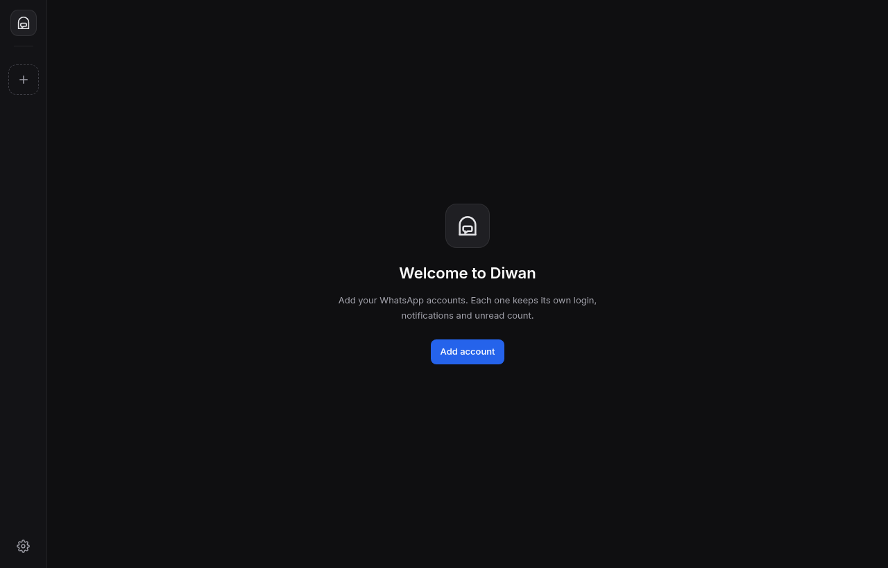
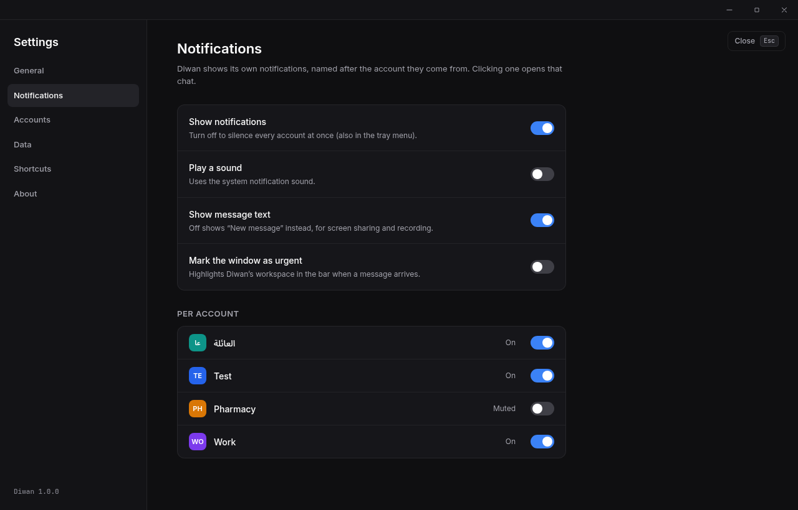

<div align="center">


# Diwan · ديوان

**All your WhatsApp accounts in one calm desktop window.**

A Linux app for people who run more than one WhatsApp: personal, work, the shop, the family group admin…
Each account stays logged in on its own, with its own notifications and unread count, one shortcut away.

[](https://github.com/yousef5/diwan/actions/workflows/ci.yml)


</div>

<p align="center">
  
  
</p>

---

## Why Diwan?

WhatsApp Web lets one browser profile log in to **one** account. If you have three numbers, you end up juggling browser profiles, private windows or your phone, and you miss messages.

Diwan solves that:

- **One window, many accounts.** Each account runs WhatsApp Web in its own isolated session, so they never see each other's cookies or data.
- **Instant switching.** Every account stays loaded in the background. Switching takes milliseconds and never reloads or logs you out.
- **You always know where a message came from.** Notifications carry the account's name, and clicking one opens that exact account and chat.
- **It feels like a native app,** not a browser tab: tray icon with an unread badge, keyboard shortcuts, spellcheck, downloads to `~/Downloads`.

## Features

**Accounts**
- Add as many accounts as you need. Each gets a name, a colour and a picture: its own WhatsApp profile photo, or one you choose.
- A slim account rail on the left, with unread badges, an offline indicator and drag-to-reorder (Alt+↑/↓ from the keyboard).
- A context bar for the open account: connection status, an **Inbox** button that jumps to the next account with unread messages, zoom, mute and reload.
- Full Arabic support: Arabic account names, right-to-left text, and an Arabic-aware unread counter.

**Notifications**
- Native desktop notifications named after the account, e.g. "Work · Ahmed".
- Mute per account, or pause everything from the tray menu.
- "Hide message text" mode for screen sharing and recording.

**Everyday comfort**
- Unread total on the tray icon and in the window title. Muted accounts don't count.
- Links open in your normal browser. `whatsapp:` links open in Diwan.
- Right-click menu with Arabic and English spellcheck.
- Close to tray, start hidden, per-account zoom, optional window buttons.

**Safe by design**
- Your settings can't be corrupted. Every save is atomic, a backup copy is kept, and a damaged file opens a read-only recovery mode instead of losing your accounts.
- WhatsApp pages are sandboxed. They can only show and close notifications; everything else is blocked and validated.
- Navigation outside `web.whatsapp.com` is stopped and sent to your browser.
- No telemetry, no servers, no accounts. Diwan talks only to WhatsApp.

**Coming from Nexus / MultiWhatsApp?** On first launch Diwan offers to import your accounts, still logged in, without touching Nexus's own data.

## Install

### Arch Linux / CachyOS / Manjaro

```sh
git clone https://github.com/yousef5/diwan && cd diwan
bun install && bunx install-electron --no
bun run package:arch
sudo pacman -U release/diwan-1.0.0-1-x86_64.pkg.tar.zst
```

Diwan then appears in your app menu as **Diwan / ديوان**. It runs natively on Wayland (Hyprland, GNOME, KDE) and falls back to X11 automatically.

Optional: let `whatsapp:` links open in Diwan:

```sh
xdg-mime default diwan.desktop x-scheme-handler/whatsapp
```

### Other distributions

An AppImage can be built with `bun run package:appimage`. It's untested outside Arch for now.

## Getting started

1. Open Diwan and click **Add account**.
2. Give it a name and a colour, then scan the QR code with WhatsApp on your phone (*Linked devices → Link a device*).
3. Repeat for each number. Switch with the rail or with **Ctrl+1…9**.

## Keyboard shortcuts

| Action | Keys |
|---|---|
| Go to account 1–9 | `Ctrl` + `1`…`9` |
| Next / previous account | `Ctrl` + `Tab` / `Ctrl` + `Shift` + `Tab` (or `Ctrl` + `PgDn` / `PgUp`) |
| Reload the account | `Ctrl` + `R` or `F5` |
| Restart the account's page | `Ctrl` + `Shift` + `R` or `Shift` + `F5` |
| Zoom in / out / reset | `Ctrl` + `+` / `Ctrl` + `−` / `Ctrl` + `0` |
| Settings | `Ctrl` + `,` |
| Hide to tray / quit | `Ctrl` + `W` / `Ctrl` + `Q` |
| Move the focused account up / down | `Alt` + `↑` / `Alt` + `↓` |
| Account menu | `Shift` + `F10` or the `Menu` key |
| Close a dialog, menu or Settings | `Esc` |

The shortcuts work even while you're typing inside WhatsApp.

## Your data

Everything stays on your computer, in `~/.config/Diwan`:

| Path | What it holds |
|---|---|
| `diwan.json` | your accounts and settings, plus a `.bak` copy |
| `Partitions/acc-<id>/` | each account's WhatsApp session |
| `avatars/`, `logs/` | account pictures and app logs |

WhatsApp sessions belong to one device. On a new computer, add your accounts again by QR.

## How it works

```
┌──────────── Diwan window (React UI) ─────────────┐
│ rail │ context bar                               │
│      ├───────────────────────────────────────────┤
│  ●   │ <webview> web.whatsapp.com  (account A)   │  each account =
│  ●   │ <webview> … hidden, still live (B, C…)    │  its own session
└──────┴───────────────────────────────────────────┘
        ▲ snapshots              │ validated IPC (zod)
        │                        ▼
   Main process: state + atomic store · notifications · tray
                 downloads · link policy · import from Nexus
```

The main process owns all state and pushes snapshots to the UI. A small sandboxed script inside each WhatsApp page reports notifications, the online state and the profile picture. Every message it sends is rate-limited and validated before it is trusted.

## Development

```sh
bun install && bunx install-electron --no
DIWAN_USER_DATA=$(mktemp -d) bun run dev   # live app on a throwaway profile
bun run typecheck && bun run lint
bun run test                               # ~770 unit and component tests
bun run e2e                                # 15 end-to-end tests, headless
```

The end-to-end suite drives the real app with Playwright. It is fully sealed: it runs headless under Xvfb with a private D-Bus, the network is blocked, WhatsApp is replaced by a stand-in page, and only throwaway folders are used. Always run it through `bun run e2e`.

**Stack:** Electron 44 · React 19 · TypeScript · Tailwind CSS 4 · zustand · zod · Vitest · Playwright · Biome · Bun.

**Design documents:** [spec](docs/superpowers/specs/2026-10-22-diwan-1.0-design.md) · [implementation plan](docs/superpowers/plans/2026-10-22-diwan-1.0.md) · [UI design](docs/design/) · [why Electron and not Tauri](docs/spikes/webkitgtk-whatsapp.py)

## Disclaimer

Diwan is an independent project. It is not affiliated with, endorsed by or connected to WhatsApp or Meta. It simply hosts the official WhatsApp Web inside a desktop window.
